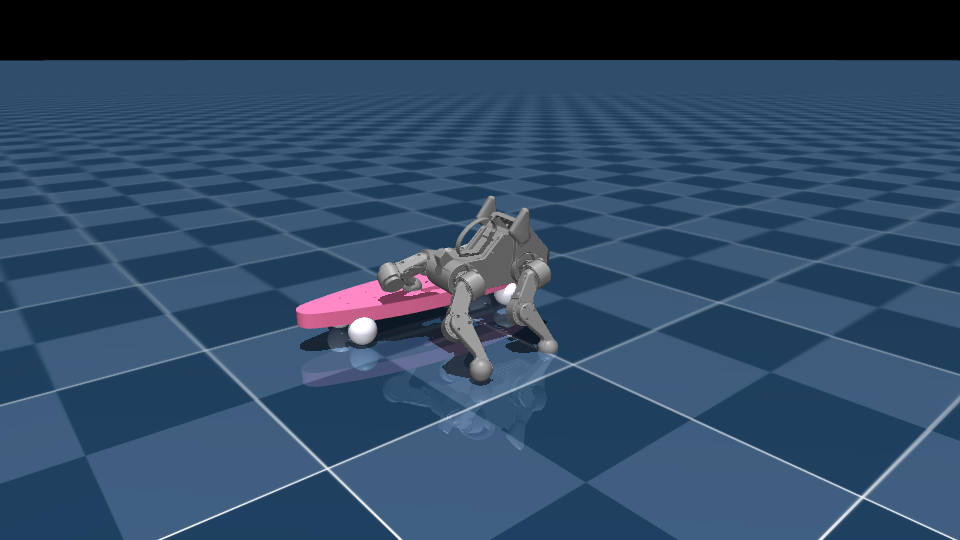

# First hardware session: test sheet

Date: ________  People: ________________________

Tests 1 and 2 use policies that pass the gait check in sim on the 103 mm deck. Test 3
is skipped this session: its policy, split ride v4, is not to be used. Test
4 uses one that fails one limit. Test 5 steers: it passes all 16 ride audit rows but
one sim board in 48 slid off on left carves. Its fallback, v7, slides less but fails
hard right carves. The first run with the right setup was on 2026-11-26, with
the placement guide: split balance held (test 1, seen in video only), and steer v6
and v10 rolled the board forward on carpet ("2026-11-26 run" below). Nothing
was measured, so no test is recorded on this sheet yet: test 1 still needs a
recorded pass, test 5 is not recorded, and tests 2, 4 and 6 are not run. The run on 2026-11-24 had the wrong
placement and an unconfirmed policy, so it does not count ("2026-11-24 run"
below). Sim first, then robot.

## Safety, before any power

- [ ] Ethan's OK for this session.
- [ ] TA sign-off for the first powered run (PLAN Task 12).
- [ ] One person holds the robot's harness or has hands ready the whole run.
- [ ] Balance tests: board on carpet, or wheels chocked.
- [ ] Everyone knows where the e-stop (kill switch) is; one person holds it.
- [ ] First run of each policy at the lowest speed.
- [ ] Deck top measured at 103 mm. If not, stop: the gait checks used 103 mm.
- [ ] Fit test with the robot powered off (SIM2REAL "Plan before the first real
      run", step 2).

Deploy: install the local file named in each test, from `policies/`. Copy it
to the robot, then in `~/pupper_gait_deploy` run
`python3 download_policy.py --file <file> --output policies/test_policy.json`
and `./deploy.sh`. Press square to start the policy; right-stick press is the
e-stop. Tests 4 and 5 need the capped `*_max0.3_policy.json` files; tests 1
and 2 use the `_policy.json` files. Do not use `./deploy.sh mjlab/<run>` for
these tests: it fetches the run's W&B export, which is not the capped file. The
file table and commands are in [`SIM2REAL.md`](SIM2REAL.md) ("Plan before the
first real run"). The robot-side commands have not yet been run with a skate
policy. Do not improvise other commands.

Stop any test at once if: a foot slips off the deck edge, a joint buzzes or
shakes, the robot leans past the hands, or anything smells hot.

## Placement (read this first)

The split stance (tests 1, 5 and 6) is not "robot on the board". Every
split policy trained with the robot standing beside the board:

- Body beside the board and parallel to it, its centre over the floor, outside
  the deck's edge. The body does not rest on the deck.
- Left feet (front left, back left) on the deck, on its centre line, one ahead
  of the board's middle and one behind it.
- Right feet (front right, back right) on the floor, right of the board.
- The body tilts toward the floor: right side lower, left side higher.

"Left" is the robot's own left. The deck side is the left in the code
(`DECK_SIDE = "l"`, `pupper_skate_split_env_cfg.py:64`).

The robot must face the board's nose. Robot and board both start at heading 0,
and the board's +x is its nose (`skateboard_constants.py:35-36`), so the ride
goes the way the robot faces, nose first. The deck trace calls the nose the
"castle end" (`board_geometry.json`, its `frame` note); no doc says how to
tell that end on the real board beyond that name. The two ends' outlines are
nearly the same (tip radii 29.6 and 30.1 mm), and the sim treats the end the
robot faces as the nose. Facing the other way does not move the foot spots
much, but the front foot then lands on the other spot and the board rolls
tail first.

The numbers, from the code and the stance tools. Foot numbers are the centre
of each foot ball, in sim; none of them has been measured on the robot.

| What | Value | Source |
| --- | --- | --- |
| Board centre line from body centre, sideways | 14.6 cm, board to the robot's left | `SKATE_SPLIT_BOARD_OFFSET` y, `pupper_constants.py:144` |
| Body centre from the board's middle, along | 1 cm ahead of it | same, x -0.01 |
| Body centre past the deck's right (near) edge | about 6.7 cm (14.6 cm less half the 157.1 mm deck) | `skateboard_constants.py:68`, worked out |
| Left feet from body centre, sideways | 14.0 cm left | `solve_split_stance.py 0.14 0.064 0.145` |
| Left feet from the deck centre line | within about 1 cm of it; varies between runs | `check_split_stance.py`, after 10 s |
| Left feet to the deck edges | 6.5 to 8.5 cm from either edge; varies between runs | `check_split_stance.py` |
| Left feet along the board | front left 7.6 cm ahead of the middle, back left 7.4 cm behind it | solver foot x (+6.57, -8.43 cm) plus the 1 cm offset |
| Left feet to the trucks | front left 10.7 cm behind the front axle, back left 10.8 cm ahead of the rear axle | axles at ±18.25 cm (36.5 cm wheelbase), `skateboard_constants.py:79`, `:193` |
| Right feet from the board centre line | about 22 to 24 cm to the right; varies between runs | `check_split_stance.py` |
| Right feet along the board | about 6.5 to 7.5 cm ahead of and behind the middle; varies between runs | `check_split_stance.py` |
| Body centre height above the floor | 15.4 cm | `SKATE_SPLIT_HEIGHT`, `pupper_constants.py:141` |
| Body tilt | 0.083 rad (4.8 degrees), right side lower | `SKATE_SPLIT_ROLL`, `pupper_constants.py:142` |
| Gap between torso and deck; how far the torso's left side overhangs the deck | not measured | |

How far off it may start: the balance task starts the board within ±3 cm
along and ±0.05 rad of heading, and the body within ±1 cm
(`pupper_skate_split_env_cfg.py:340-353`). The ride and steer start the board
within ±3 cm along, ±2 cm sideways and ±0.15 rad (`:553-557`). So place the
body within about 1 cm of its spot, the board's middle within about 3 cm of
the body's along the deck, and the robot square to the board. Tape marks on
the deck centre line, about 7.5 cm ahead of and behind the board's middle,
give the two left-foot spots.

Sim, steer v6 riding straight at 0.3 m/s (frame 125), seen from above and to
the robot's right: right feet on the floor, left feet on the deck, body
beside the board. The torso seems to overlap the deck only because of the
camera angle.

Wrong, as in the 2026-11-24 videos (the TA read them the same way):

- Body on top of the deck.
- Left legs past the far (left) edge of the deck.
- Body resting on the deck.

Each gives the policy a stance it never trained on, with nothing under the
left feet.

Which file to install for each test (all under `policies/`):

| Test | File |
| --- | --- |
| 0 | none, robot off |
| 1 | `split_balance_v3_policy.json` |
| 2 | `centred_balance_v2_policy.json` |
| 3 | skipped this session: no file. Split ride v4 is not to be used (not ready, SIM2REAL "Short answer"). The straight ride is test 5's first step, steer v6 at yaw 0 |
| 4 | `centred_ride_v9_max0.3_policy.json` (provisional) |
| 5 | `split_steer_v6_max0.3_policy.json` first; then `split_steer_v10_max0.3_policy.json` (provisional, run second, same placement and steps, to compare on carpet); `split_steer_v7_max0.3_policy.json` only if v6 slides along the deck, on a hard floor or once the board rolls (fallback, full stick only: `split_steer_v5_max0.3_policy.json`) |
| 6 | `split_steer_v6_max0.3_policy.json`, as gemini_pupper's `skate/policy.json` |

Steer v6 stays the ride candidate and the file to run first. Steer v9 was
evaluated and not exported. Steer v10 is provisional and does not replace
v6: it passes every ride audit row v6 passes, and is faster at wheel drag x6
to x15, but misses its pass bar at x10.

## 0. Board tilt stiffness (robot off, no power)

Decides whether steering is possible at all (SIM2REAL "Steering: what sim
says"). Takes five minutes.

- Board on a hard floor, wheels chocked. Phone with a level app flat on the
  deck, across the board.
- Hang or press a known weight on one long edge of the deck, midway between
  the trucks: 1 kg, then 2 kg, then 3 kg (the robot is about 3 kg). Read the
  tilt each time.
- Repeat with both kingpin nuts loosened one full turn.
- Steering by lean needs about 7.5 to 15 degrees at 3 kg (9 to 18 N·m/rad,
  worked out below). Under 7.5 degrees the trucks are stiffer than the steer
  policy trained on; over 15 degrees they are softer (under 9 N·m/rad). Either
  way, do not run test 5. The one exception: test 5's single straight repeat
  with the trucks tightened (stick centred, no carve, hands on), which is
  outside this range on purpose.
- Tilt at 1 / 2 / 3 kg, stock: ______ / ______ / ______ degrees
- Tilt at 1 / 2 / 3 kg, loosened: ______ / ______ / ______ degrees
- Stiffness k = m x 9.81 x d / tilt, with m in kg, d the weight's distance from
  the centre line in m and the tilt in rad. 3 kg on the edge (d about 0.0805 m,
  half the 161 mm measured deck; the sim's traced outline is 157.1 mm) is
  2.4 N·m, so 9 to 18 N·m/rad, the range test 5
  needs, is about 7.5 to 15 degrees at 3 kg.
- k at 3 kg, loosened: ______ N·m/rad

Carpet drag (two minutes, robot off). No hardware evidence measures the
carpet's wheel drag yet; the sim estimate (x5 to x10 of nominal) is a
textbook figure, and v10 is solid in sim only to x6. This measures it.

- Board on the test carpet, wheels free (not chocked), loosened trucks. Put
  about 1.2 kg on the deck, near its middle.
- Hook a luggage scale or a kitchen scale to the nose truck and pull the
  board along the carpet, level, at a steady slow walk. Read the force once
  it is rolling steadily, not the jerk at the start.
- Force in N = kg on the scale x 9.81 (grams x 0.00981). Nominal sim wheel
  drag is about 0.28 N in total, so the drag multiple is force / 0.28.
- Force on carpet: ______ N. Drag multiple (N / 0.28): x______

## 1. Split balance

- Policy: `policies/split_balance_v3_policy.json` (run `gt60lfo0`)
- First because two feet stay on the floor, so a failure is a small one.
- Placement: split stance, as in "Placement (read this first)". Wheels
  chocked.
- Watch: right feet stay planted; right side about 5 degrees lower, left side
  higher, as in sim; board does not creep.
- Pass: holds still for 10 s with hands off. Stop: a right foot lifts, the
  left feet slide, or it shakes.
- Notes: ____________________________________________

## 2. Centred balance

- Policy: `policies/centred_balance_v2_policy.json` (run `zdctdcyf`)
- Placement: all four feet on the deck. Centre the board under the robot to
  within about 1 cm. Wheels chocked.
- Watch: feet stay on the deck, not the edge; body still; no shaking.
- Pass: holds still for 10 s with hands off. Stop: any foot near the edge, any
  shake, any sideways drift.
- Notes: ____________________________________________

## 3. Split ride (skipped this session)

Skipped this session: split ride v4 is not to be used (not ready, SIM2REAL
"Short answer"). The straight ride is the first step of test 5, with steer v6
at yaw 0. Do not install any `split_ride_*` file.

## 4. Centred ride, tripod (provisional: Ethan decides)

- Policy: `policies/centred_ride_v9_max0.3_policy.json` (run `7fyt12i1`).
  It clips at 0.3 m/s. Install it as in "Deploy" above.
- Gait check: `GAIT: FAIL` on one limit. The push foot is on the floor 20% of
  the time (limit 40%). Every other limit passes at 0.1, 0.2 and 0.3 m/s
  (SIM2REAL "Riding: where it stands"). Run this test only if Ethan accepts
  that, and only after tests 1 and 2.
- Placement: front right, front left and back left feet on the deck, body
  centred within about 1 cm. Back right foot on the floor beside the board.
  It starts there; it does not step off the deck.
- Hands on the harness the whole run. The robot stands on three feet for most
  of the ride.
- Speed: a light push of the stick (0.2 m/s) first. Do not test 0.1 m/s: the
  pushes there are short taps.
- Watch: one short push with the back right foot about once a second, then a
  glide with that foot in the air; the other three feet stay on the deck;
  body upright.
- Pass: several push-and-glide cycles at 0.2 m/s with no fall. Stop: a deck
  foot slips toward the edge, the body tips toward the lifted foot, fast
  tapping, or the robot drops onto the deck.
- Notes: ____________________________________________

## 5. Split steer, lean carving (candidate: Ethan decides)

- Policy: `policies/split_steer_v6_max0.3_policy.json` (run `hfd3qhwr`,
  resumed from v5). It clips speed at 0.3 m/s and yaw at 0.6 rad/s, and
  passes the robot-side validator (`download_policy.py --validate-only`).
  Install it as in "Deploy" above.
- This is a candidate for the first steering test, not a fully passing policy.
  Ride audit: `PASS` on 16 of 16 rows. Gait check: `GAIT: PASS` at yaw 0,
  ±0.15, -0.3, -0.5 and -0.6. Left carves of +0.3, +0.5 and +0.6 fail on one
  sim board in 16 (the same one each time), which slid 8 cm along the deck.
  On two more seeds those left carves had no reset: 1 board in 48 in all.
- Steer v10, second: `policies/split_steer_v10_max0.3_policy.json` (run
  `74jsd4gb`, resumed from v9 `d63ab512`). Provisional, run second, same
  placement and steps, to compare on carpet. Run v6 first. v10 does not
  replace v6 and did not pass its own bar. Before installing it, check it
  on the robot with `python3 download_policy.py --validate-only <file>`, as
  for any file; it passed that check on the Mac. v10 trained on wheel drag
  up to x10 (the carpet's drag is not measured; test 0 measures it). Same
  clips as v6 (speed 0 to 0.3 m/s, yaw ±0.6 rad/s) and same heading hold
  (kp 1.0, clip 0.1). In sim it passes 18 of 21 ride audit rows, every row
  v6 passes, and is faster than v6 at drag x6 to x15: 0.96 of the asked
  speed at x6 with no resets; at x10 it reaches only 0.58, with 4
  `board_drifted` resets on 3 boards. The gait check was run on three seeds
  at stick 0, ±0.15, ±0.3 and ±0.5: 22 of 23 runs pass (with ±0.6 on seed 0
  only), and one resets, on a hard right carve (seed 1, stick -0.5). Its
  largest fore-aft slide along the deck is 3.8 to 7.2 cm, against the 8 cm
  reset limit, so "no resets" does not mean it slides less than v6. v10:
  stop at about ±0.5; ±0.6 is checked on one seed only. Expect, in sim:
  gentle left carves turn up to about twice what is asked, right carves
  about 0.6 to 1.0 of asked, and a slight pull with the stick centred to
  either side, depending on the board: a few degrees in 5 s (the two sim
  tools disagree on its sign; they use different windows).
- If the robot slides along the deck with v6, on a hard floor or once the
  board rolls: try `policies/split_steer_v7_max0.3_policy.json` (run
  `n5m2zsks`, resumed from v6), after v6 and v10. Keep the stick within
  ±0.3; the file clips yaw at ±0.3 rad/s
  anyway. It passes the validator and all 16 ride audit rows, and no sim
  board slid out in 27 gait runs. But it pulls right, gentle right carves
  turn up to 2.1 times what they ask, and hard right carves (stick -0.5,
  -0.6) fail in sim on every seed, so it does not get the full stick. The
  cause of the right pull is not known yet. Same heading
  hold as v6 (kp 1.0, clip 0.1). Same placement and trucks.
- Fallback: `policies/split_steer_v5_max0.3_policy.json` (`bxke67fj`), full
  yaw stick only. It trained only on full carves and fails 2 of 16 ride
  audit rows. Its heading hold clip is 0.3, not 0.1.
- Straight ride, for v6 and then v10, before any carve. The 2026-11-26 clips
  show the nose swinging on each kick and the board drifting to one side;
  this measures how much.
  - Wireless gamepad, or a second person holds the cable slack above the
    robot: the cable dragged from the robot in both 2026-11-26 clips.
  - Record the truck state: loosened (the test 0 reading, 9 to 18 N·m/rad)
    is the trained range; stock and tightened are both outside it. Run
    loosened first. If the nose swings more than about 1 cm side to side on
    each kick, repeat that policy's straight ride once with the trucks
    tightened (the one exception in test 0): stick centred, no carve, hands
    on. Stop if the board will not roll. Loosen the trucks back to the test
    0 range before any further run.
  - Lay a 2 m tape line on the floor with a mark every 10 cm, board on the
    line. Fix the camera (not hand-held) looking down the line. It sees
    sideways motion well and distance badly, so read distance from the tape
    marks, not by eye from the picture.
  - Stick fully forward for 5 s from the first push, yaw centred. Record: the
    distance along the line (the tape mark beside the deck's middle at 5 s);
    the sideways distance of the deck's middle from the line at the end, in
    cm; the nose's side-to-side travel on each kick against the tape, in cm
    (if it cannot be read, y/n for whether it swings); and whether the feet
    slid along the deck.
  - Sim, steer v6 and v10 on a hard floor (`PLAN_STRAIGHT.md`, baseline): about
    1.5 m in 5 s. At wheel drag x6, about 1.4 m for v10 and about 1.05 m for
    v6. Drift: a single sim board ends up to about 10 cm to either side in
    5 s (the worst 8 to 12 cm), and tens of cm over a 25 s ride, so drift is
    expected and is not by itself a sim-to-real gap. On rides longer than
    this 5 s one, steer back with the stick; do not expect the board to hold
    the line. Nose swing in sim: about 0.5 to 1.5 degrees per board, under
    1 cm of side-to-side travel at the nose. A clearly larger swing points
    to something the sim does not model or did not exercise.
- On carpet, compare the straight ride first; carve only if the board rolls.
  Carves at carpet drag are not checked in sim for either file.
- If neither file rolls on carpet with correct placement, repeat the straight
  ride on a hard floor, hands on, and record the same things as the straight ride
  (distance, sideways cm, nose travel cm, feet slid y/n). That run tells "placement or policy" apart from "carpet".
- v10 standing still without stroking, or the board creeping sideways, is its
  known sim behaviour at high drag (at x15 it rides 0.26 of asked, at x25
  0.03, and the board drifts sideways at x10 and x15): stop and note it.
- Needs Ethan's OK and a TA sign-off for this test, and test 1 passed first.
  It also stands in for test 3: its first step, the straight ride at yaw 0,
  is the split ride for this session. With test 3 skipped there is no
  straight ride on stock trucks this session: the first roll test depends on
  the loosened trucks.
- Trucks: loosen the kingpin nuts until test 0 reads 9 to 18 N·m/rad. The
  policy trained only on that range. The single tightened straight repeat
  above is the only run outside it. The stock trucks have not been
  measured; they are assumed much stiffer, and then the board will not turn.
- There is no foot stop or ridge on the deck, and none will be fitted.
  Staying on the board comes from the policy alone. Sliding along the deck is
  the main open risk: in sim the left feet slowly slide toward the nose or
  tail, up to 8.0 cm on left carves. Keep each run short, about 10 s, and
  reset the robot to its marks between runs.
- Placement: split stance, as in "Placement (read this first)". Place the
  robot square to the board, body parallel to the deck.
- This file has the heading hold on (kp 1.0, clip 0.1 rad/s). On the robot the
  hold keeps the robot's own IMU yaw, not the board's heading: it cannot see
  the board. Any yaw between robot and board when the hold captures stays
  locked in. After each carve, check the body is still parallel to the board
  before the next run. The other skate files have the hold off.
- Speed: the forward stick, clipped at 0.3 m/s. Sim checked only 0.3 m/s.
- First ride straight at yaw 0. Then carve with a small stick, about 0.15
  rad/s, each way. Only then try more stick, up to full (0.6) for v6 (v10:
  stop at about ±0.5; ±0.6 is checked on one seed only). Partial stick
  is allowed: v6 trained on carves of 0.1 to 0.6 rad/s, and a half stick asks
  for about half the turn. Do not hold the stick right at 0.1: that sits
  between the heading hold and the smallest carve. Back to yaw 0 holds the
  new heading (the robot's own, see above).
- Expect a slow lean turn. In sim the board turned about 0.8 of what it asks
  at stick 0.15 and 0.6, but only about 0.6 at stick 0.3. In 10 s renders
  the board's heading changed +0.17 rad at stick 0.15, +0.63 rad at stick
  0.6 and -0.20 rad at stick -0.3.
- Watch: the robot leans its weight toward one deck edge; the board turns that
  way; left feet stay put on the deck.
- Pass: the board turns each way for a few seconds with no fall, then rides
  straight again at yaw 0. Stop: a left foot slides toward the nose or tail or
  off the deck, the robot turns but the board does not, or fast stamping legs.
- Notes straight (v6, then v10): ________________________________________
- Notes carve left, small stick: ____________________________________________
- Notes carve right, small stick: ____________________________________________
- Notes carve, more stick: ____________________________________________
- v6 on carpet: distance in 5 s ______ m; sideways from the line ______ cm;
  nose travel on each kick ______ cm (or swings y/n ____); feet slid along
  the deck (y/n) ____; trucks stock / loosened / tightened ____; cable slack
  (y/n) ____
- v10 on carpet: distance in 5 s ______ m; sideways from the line ______ cm;
  nose travel on each kick ______ cm (or swings y/n ____); feet slid along
  the deck (y/n) ____; trucks stock / loosened / tightened ____; cable slack
  (y/n) ____
- Tightened repeat, if run (v6 / v10): ____; distance in 5 s ______ m;
  sideways ______ cm; nose travel ______ cm (or swings y/n ____); rolled
  (y/n) ____
- v10 stood still or the board crept sideways (y/n, which): ________________
- Hard floor, only if neither rolled on carpet: v6 ______ m, ______ cm
  sideways, nose ______ cm (or y/n ____), slid (y/n) ____; v10 ______ m,
  ______ cm sideways, nose ______ cm (or y/n ____), slid (y/n) ____
- Notes v7, if used (straight, then stick ±0.15, ±0.3): ______________________

## 6. Voice control (Gemini Pupper)

Not run yet. Needs Ethan's OK on the day, a TA's sign-off for the policy,
and test 5 (straight ride and steer by joystick) passed first. The voice
tools assume the ride and the steer work. Nothing in this test has run on the
robot: every distance and turn Gemini gives is a sim estimate.

Setup, by Ethan on the robot:

- [ ] `git pull` the `skate-voice` branch of gemini_pupper on the robot. The
      robot's copy may be ahead of the Mac snapshot: merge, do not overwrite.
- [ ] `python3 lab/test.py skate` on the robot: all checks pass.
- [ ] `robot/start.sh`, with Pupper lying on the floor, away from the board.
      In `/tmp/gemini-pupper/robot.log` the spawner lists `gemini_skate` as
      loaded.
- [ ] `ros2 control list_controllers` lists `gemini_skate` as inactive. It
      must not be active before "start skating".
- [ ] `ros2 param get /gemini_skate model_path` ends in `skate/policy.json`.
- [ ] Joystick connected. Right-stick press is the e-stop and outranks
      Gemini.

Run, hands on the harness the whole time, 4 m of clear floor ahead:

- The gamepad joystick outranks Gemini and is outside every server guard. It
  can carve harder than the voice limits, and its controller-switch buttons
  bypass the board guard. While Pupper is on the board, do not touch the
  sticks or the switch buttons: use the gamepad for its e-stop only.
- Lift Pupper off the board onto the floor before any "stand up" meant to
  stand it. The one "stand up" said on the board (the e-stop step) checks
  that it is refused.

- [ ] Say "lie down". Place Pupper in the split stance ("Placement (read
      this first)"). Say "start skating". Pass: Gemini
      asks whether Pupper is placed before it starts; Pupper eases into the
      stance and balances for 10 s without rolling.
- [ ] E-stop check, still balancing, both hands on the harness: press the
      gamepad e-stop (right-stick press). Pass: the motors relax at once,
      and `ros2 control list_controllers` lists `gemini_skate` as inactive.
      Pupper is now relaxed on the board, and the board guard stays on: say
      "stand up". Pass: Gemini refuses and says Pupper is on the board;
      Pupper does not move. "Stand up" stays refused until "get off the
      board". Place Pupper again if it moved, and say "start skating". Pass:
      Gemini asks whether Pupper is placed; Pupper eases into the stance and
      balances.
- [ ] Say "walk forward". Pass: Gemini refuses and says why. Pupper does not
      move.
- [ ] Say "go forward". Pass: rides about 3 s, then stops pushing.
- [ ] After that ride, watch the right legs for 5 s. Pass: they stay planted
      and do not push again; the zero command really stops the pushing.
- [ ] Say "go forward", and about 1 s into the ride say "stop". Pass: pushing
      stops within 1 s, the right legs stay still afterwards, and Pupper
      stays in skate mode, balancing.
- [ ] Say "turn gently left". Pass: Gemini calls a gentle carve (0.15 rad/s);
      Pupper leans left and the board's heading moves left, if only a few
      degrees. If it rides dead straight, the gentle carve is not getting
      through the cmd_vel mux: write it down, and do not raise the carve.
- [ ] Say "turn left", then "turn right". Pass: the board curves the right
      way; Pupper stays on.
- [ ] Hold the harness, say "get off the board". Pass: Gemini asks if Pupper
      is held, then the motors relax. If a ride is still queued, end_skating
      waits for it: say "stop" first to end at once.
- [ ] Set up the tip test. Pupper is relaxed on the board from the step
      above. Place it again if it moved, in the split stance ("Placement
      (read this first)"). Say "start skating". Pass:
      Gemini asks whether Pupper is placed before it starts; Pupper eases
      into the stance and balances without rolling.
- [ ] Tip test, still balancing (no ride queued), both hands on the harness:
      tilt Pupper slowly until the tilt e-stop fires. Say "walk forward", then
      "do a trick". Pass: both are refused and Pupper does not move, and
      Gemini says to hold Pupper and end skating, not to stand up. Hold
      Pupper, say "get off the board". Pass: the motors relax. Lift Pupper
      off the board onto the floor, say "stand up". Pass: it stands.

Stop the test (e-stop) if a left foot nears the deck edge, a right foot
lands on the deck, the board heads for anything, or a motor faults.

Measure and write down, to replace the sim estimates in `skate/skate.yaml`:

| What | Sim estimate | Measured |
| --- | --- | --- |
| Distance in a 3 s ride (tape on the floor) | 3 × `travel_m_per_s` = 3 × 0.29 = about 0.9 m | |
| Roll after the last push | `coast_m` = 0.1 m | |
| Heading change in a 5 s hard carve, each way | 5 × `turn_deg_per_s.hard` = 5 × 2.2 = about 11° | |

The sim numbers come from `skateboard/tools/timed_ride.py` on steer v6 (16 envs,
5 s ride, no resets at any carve level). The turn value is the weaker side's, rounded to
0.1.

## 2026-11-26 run

Gates carpet, with the placement guide. This is the first run with the right
setup. It is video only and nothing was measured, so no test is recorded
from it. From the teammates' report and clips:

- Split balance held.
- Steer v6 and steer v10 each rolled the board forward for the whole clip,
  about 29 s and 28 s as reported. The clip-to-policy match (29 s is v6, 28 s
  is v10) comes from those lengths, not from a check.
- The nose swung a little on each kick and the board drifted to one side.
- Speed and distance were not measured. The camera moved.
- A wired gamepad cable dragged from the robot in both clips.
- Truck tightness was not recorded.

In sim (`PLAN_STRAIGHT.md`, baseline and long ride) the nose swings only
about 0.5 to 1.5 degrees per kick, so a clearly visible swing points to
something the sim does not model or did not exercise: the cable, truck
stiffness on the day, or the carpet. The board drifts sideways in sim too,
tens of cm over a clip-length ride, either side, so the drift in the clips
is not shown to be a sim-to-real gap. Neither speed nor drift has been
measured on the robot. This run does not say v10 passed its bar or replaces
v6. The straight ride block in test 5 measures it.

## 2026-11-24 run

Seen in the videos: balance held for 17 to 18 s in two clips. The ride did not
roll: the floor legs stroked and the board stayed put. In one clip the robot
crept along the deck toward the nose over about 10 s
([`PLAN_CARPET.md`](PLAN_CARPET.md)). Placement was not as specified (see
"Placement (read this first)"), and the policy version was not confirmed as
specified: `PLAN_CARPET.md` logs the ride as steer v6, but the team may have
run split ride v4, which is not ready. So the run does not count as a test of
steer v6. The carpet work
([`PLAN_CARPET.md`](PLAN_CARPET.md), steer v9 and v10) is insurance, not a confirmed
cause.
